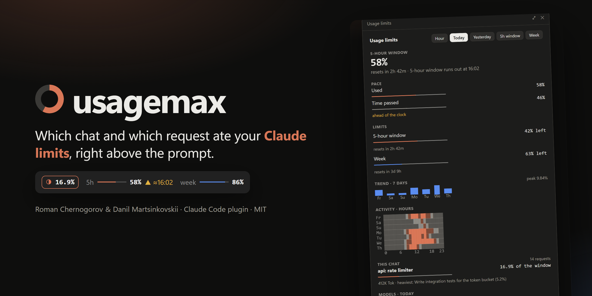
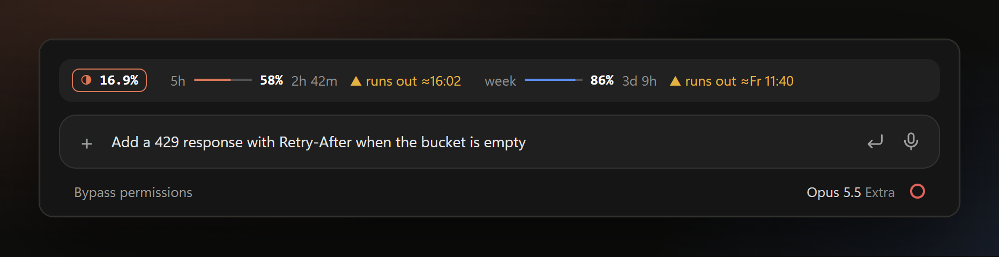
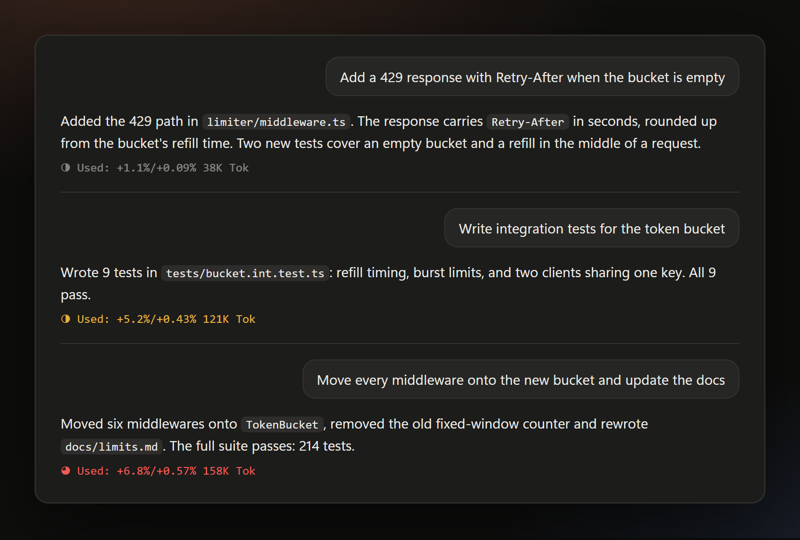
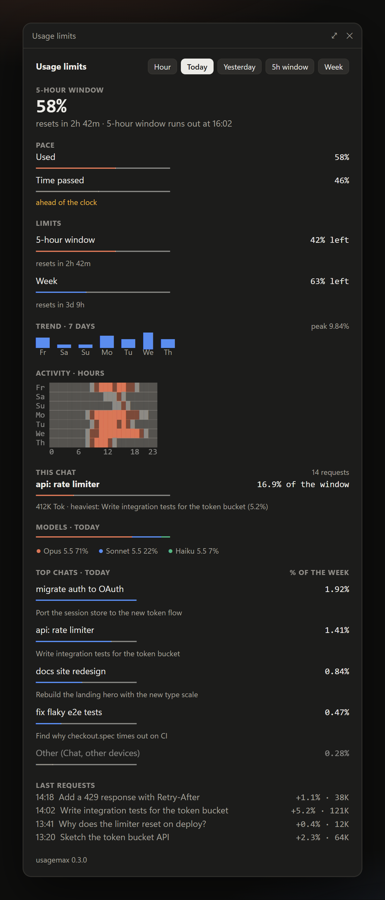
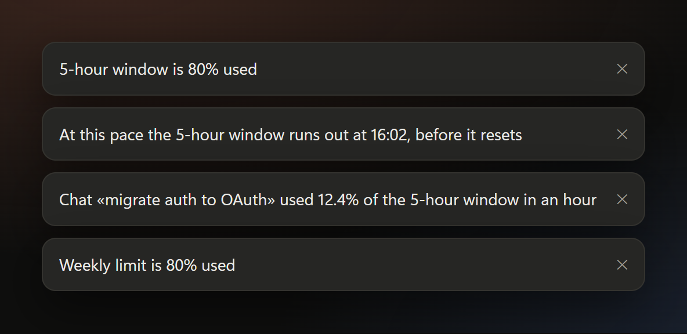

<p align="center">
  
</p>

<p align="center">
  <a href="#install"></a>
  <a href="https://github.com/Aristosya/usagemax/releases"></a>
  <a href="LICENSE"></a>
</p>

<p align="center">
  
  
  
  
  
  
  
</p>

<p align="center">
  <b>usagemax</b> is a Claude Code plugin for the Code tab of Claude Desktop.<br>
  It shows what each request and each chat cost you in the <b>5-hour window</b> and the <b>weekly limit</b>.<br>
  <sub>by Roman Chernogorov &amp; Danil Martsinkovskii</sub>
</p>

<p align="center">
  <a href="#what-you-get">What you get</a> ·
  <a href="#install">Install</a> ·
  <a href="#how-the-percent-is-computed">How it counts</a> ·
  <a href="#commands">Commands</a> ·
  <a href="#settings">Settings</a> ·
  <a href="#faq">FAQ</a>
</p>

---

## What you get

### A band above the prompt



The orange chip shows this chat's share of the current 5-hour window. Next to it: the 5-hour window and the week, each with a bar, the percent used and the time to reset. When a limit's recent pace would use it up before its reset, a yellow estimate follows it: `▲ runs out ≈16:02`. The 5-hour estimate needs 15 of the last 30 minutes, the weekly one 6 of the last 24 hours, so a fresh window shows no estimate. In a narrow window the band stays on one row: it shortens the estimates, then drops the times to reset, then the bars. The band lights up under the pointer; click anywhere on it to open the panel. The band shows up as soon as a chat sends its first request.

Claude reports the limits only with an answer, so the band refreshes itself every minute: the time to reset counts down, and an answer in another Code chat on this computer shows up here within a minute. Usage from the Chat tab, the phone or another computer appears after the next answer in any Code chat.

### A line under every answer



`◑ Used: +5.2%/+0.43% 121K Tok`

| Part | Meaning |
| --- | --- |
| `◑` | How full the 5-hour window is: `○ ◔ ◑ ◕ ●` |
| `+5.2%` | This request's share of the 5-hour window |
| `+0.43%` | This request's share of the weekly limit |
| `121K Tok` | Tokens sent and written, cache reads left out |

With `"footer": "tree"` the line turns yellow from 3% of the window and red from 6%.

### The panel



- **5-hour window** with time to reset and a run-out forecast
- **Pace**: window used against time passed
- **Limits**: 5-hour and weekly, each with its reset time
- **Trend** for 7 days and an **activity heatmap** by hour
- **This chat**: total, heaviest request, last 10 requests
- **Models**: share of Opus, Sonnet, Haiku and Fable for the period
- **Top chats** for the hour, today, yesterday, the 5-hour window or the week
- **Other** row: usage no Code-tab chat explains (Chat tab, phone, another computer)

<br clear="right">

### Toasts



| When | Toast |
| --- | --- |
| 5-hour window reaches 80% and 90% | `5-hour window is 80% used` |
| Weekly limit reaches 80% | `Weekly limit is 80% used` |
| The window runs out before the reset at this pace | `At this pace the 5-hour window runs out at 16:02, before it resets` |
| One chat used over 10% of the window in an hour | `Chat «…» used 12.4% of the 5-hour window in an hour` |

## Install

Requirements: Claude Desktop with the Code tab and a Claude subscription with the 5-hour and weekly limits, such as Pro or Max. Tested with Claude Code 2.1.304 on Windows 11.

```bash
claude plugin marketplace add Aristosya/usagemax
```

```bash
claude plugin install usagemax@usagemax --scope user
```

New chats load the plugin. An open chat picks it up after `/reload-plugins`.

<details>
<summary>The <code>claude</code> on PATH is older than the one Claude Desktop runs</summary>

Claude Desktop keeps its own copy under `%APPDATA%\Claude\claude-code\<version>`. In PowerShell:

```powershell
$CC = Get-ChildItem "$env:APPDATA\Claude\claude-code" -Directory | Sort-Object { [version]$_.Name } -Descending | Select-Object -First 1 | ForEach-Object { (Get-ChildItem $_.FullName -Recurse -Filter claude.exe | Select-Object -First 1).FullName }
```

```powershell
& $CC plugin marketplace add Aristosya/usagemax
```

```powershell
& $CC plugin install usagemax@usagemax --scope user
```

</details>

### Update

When a new version is out, usagemax says so in a toast. Press **Update** in **Settings → Your plugins → Usagemax**, then start a new chat or run `/reload-plugins`.

Claude Code's Update button compares against its own copy of this repository, and for a third-party marketplace it refreshes that copy only with auto-update on. So usagemax refreshes it itself: a few seconds after a chat starts, at most once an hour, it runs `git fetch` on that copy. A plugin added from a local folder is left alone.

Versions before 0.5.4 lack this. To get past them once:

```bash
claude plugin marketplace update usagemax
```

```bash
claude plugin update usagemax@usagemax
```

To have Claude Code install new versions by itself: run `claude`, type `/plugin`, open **Marketplaces**, select **usagemax**, then **Enable auto-update**.

### Uninstall

```bash
claude plugin uninstall usagemax@usagemax --scope user
```

```bash
claude plugin marketplace remove usagemax
```

## How the percent is computed

Claude Code reports limit usage in whole percents. A small request moves the counter by 0 or 1 point, and that difference tells you nothing.

usagemax prices each request's tokens by Anthropic's list prices and learns one rate per window for the whole account: how far the counters grew over the last 7 days, divided by the cost of every request in that span. A request's share is its cost times the rate. A request that moved the window by 10 points or more on its own shows the measured difference instead.

During the first hours the rate has no data, and the line shows tokens only.

## Commands

| Command | Shows |
| --- | --- |
| `/usagemax` | The panel |
| `/usagemax top [hour\|today\|yesterday\|5h\|week]` | Top chats as text, today by default |
| `/usagemax chat` | Every request of this chat |
| `/usagemax hour` | Top chats for the last hour |

## Settings

`%USERPROFILE%\.claude\usagemax\settings.json`, optional:

```json
{ "footer": "tree", "selfUpdate": true }
```

| `footer` | Line under the answer |
| --- | --- |
| `text` (default) | Plain text from Claude Code |
| `tree` | Drawn by usagemax: yellow from 3% of the 5-hour window, red from 6% |
| `rewrite` | Added to the end of the answer as code |

| `selfUpdate` | Update check |
| --- | --- |
| `true` (default) | Refresh this repository's copy from GitHub at most once an hour, so the Update button finds new versions |
| `false` | No network at all |

A new mode applies from the next answer. The plugin speaks English. It switches to Russian when Claude Code's `language` setting is Russian.

## Data and privacy

| Path | Contents |
| --- | --- |
| `%USERPROFILE%\.claude\usagemax\sessions\<chat id>.json` | One chat's requests: time, first 120 characters of the prompt, tokens, limit readings, share |
| `%USERPROFILE%\.claude\usagemax\settings.json` | Settings |

- Each chat writes its own file. Records older than 30 days go away when a chat starts.
- Chat titles come from Claude Code's local transcripts.
- The one network call is that update check: `git fetch` of this repository, at most once an hour, only when you installed from GitHub. It sends nothing about you or your usage. `"selfUpdate": false` turns it off.

## FAQ

<details>
<summary><b>Does it count the Chat tab?</b></summary>

No. Usage from the Chat tab, the phone app and other computers shows up in the <b>Other</b> row of the top.
</details>

<details>
<summary><b>Why does the line show <code>–</code> or tokens only?</b></summary>

The account rate needs a few hours of requests. Until then usagemax shows tokens, and <code>–</code> where a share is unknown.
</details>

<details>
<summary><b>Does it work with an API key?</b></summary>

API-key sessions have no 5-hour or weekly window. The line shows tokens only.
</details>

<details>
<summary><b>Where do the prices come from?</b></summary>

From Anthropic's list prices per model: input, cache write, cache read and output. Only the ratio between requests matters, because the rate turns cost into percent.
</details>

<details>
<summary><b>Does it send my prompts anywhere?</b></summary>

No. It stores the first 120 characters of each prompt in a local file and deletes them after 30 days.
</details>

## Development

```bash
claude plugin test .
```

```bash
claude plugin validate .
```

| Path | Role |
| --- | --- |
| `hooks/register.tsx` | Entry point |
| `hooks/capture.ts` | Records each request with its tokens and limit readings |
| `hooks/button.tsx`, `hooks/band-client.tsx` | Band above the prompt: data, and the surface module that draws it and hears the click |
| `hooks/footer.tsx`, `hooks/panel.tsx` | Line under the answer, panel |
| `hooks/toasts.ts`, `hooks/commands.ts` | Toasts and `/usagemax` |
| `hooks/lib/` | Prices, rate, reports, formatting |
| `tests/` | Tests for `claude plugin test` |

## Developers

- Roman Chernogorov
- Danil Martsinkovskii

## License

[MIT](LICENSE) © 2026 Roman Chernogorov, Danil Martsinkovskii
